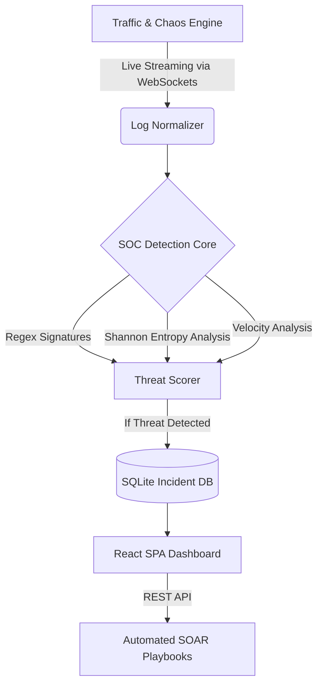

# 🛡️ Aapki Nazar: Next-Gen Automated SOC & SIEM Platform

[](https://nodejs.org/)
[]()
[]()

**Aapki Nazar** is a real-time, Automated Security Operations Center (SOC) and SIEM platform designed for multi-vector threat detection, live telemetry streaming, and automated incident triage. It natively ingests massive gigabyte-scale academic and enterprise datasets to dynamically simulate, detect, and escalate cyber attacks.

---

## 🎯 1. Project Overview & Novelty

Modern network environments produce overwhelming volumes of telemetry data. Manually analyzing unstructured logs across varying formats introduces significant detection latency and analyst fatigue. 

**Our Solution:** Aapki Nazar demonstrates an automated approach to parsing, analyzing, prioritizing, and triaging security incidents with deterministic explainability. It integrates format-agnostic log normalization, configurable signature detection, entropy/velocity-based behavioral indicators, forensic evidence packaging, and simulated SOAR (Security Orchestration, Automation, and Response) into a single, lightweight workflow.

## 🏗️ 2. Architecture & Data Flow

The platform operates on a decoupled Node.js microservice architecture over an embedded SQLite persistence layer.



## 🔍 3. 5-Stage Detection Pipeline

1. **Universal Normalization:** Heuristically extracts routing and payload data from varying formats (AWS CloudTrail, Splunk Syslog, Apache CLF).
2. **Signature Detection:** Executes bounded multi-pass decoding followed by configurable Regex rule matching (e.g., SQLi, XSS, CMDi, SSRF).
3. **Velocity Analysis:** Tracks request rates via an in-memory sliding window cache to detect DDoS and Brute Force anomalies.
4. **Entropy Analysis:** Calculates Localized Shannon Entropy ($H > 5.8$) on payload contents to detect obfuscated attacks or packed exploit code.
5. **Composite Scoring:** Deterministically aggregates risk variables to prioritize analyst attention.

## 📊 4. The Data Engine (110k+ Real Logs)

Unlike standard simulators that rely on synthetic strings, Aapki Nazar is powered by a massive hybrid engine of real-world academic and enterprise data:

- **CSIC 2010 Academic HTTP Dataset:** 36,000 real-world normal requests and 24,000+ hand-crafted anomalous web attacks.
- **Benign Traffic Baseline:** Native, unmodified Apache Server Access Logs and AWS CloudTrail API events.
- **Splunk BOTS v3:** Raw Windows and enterprise SIEM log excerpts.
- **SecLists & OWASP Core Rule Set:** Live ingestion of highly advanced enterprise fuzzing dictionaries and ModSecurity regressions.

## 🚨 5. Incident Management & Risk Scoring

Incidents automatically transition through a strict state machine (`OPEN` → `IN_PROGRESS` → `RESOLVED`). The Threat Score is deterministically bounded to a maximum of 100, calculated as follows:

* **Base Severity Limits:** LOW (25), MEDIUM (50), HIGH (75), CRITICAL (90)
* **Algorithmic Modifiers:**
  * *High Entropy Payload:* +10 Points
  * *Velocity Anomaly:* +15 Points
  * *Multiple Rule Violations:* +5 Points (per additional trigger)

All detections are systematically mapped to the **MITRE ATT&CK Framework** (e.g., *T1190: Exploit Public-Facing Application*) for industry-standard compliance.

---

## 🚀 6. Installation & Setup

### Prerequisites
- Node.js v16.x or higher installed.

### Start the Platform
```bash
# 1. Install dependencies
npm install

# 2. Boot the server and Chaos Engine
npm start
```
Navigate to: **[http://localhost:3001](http://localhost:3001)**

### Dashboard Reset
To wipe all live alerts and reset the SQLite database to a pristine, 0-alert state for demonstrations:
```bash
npm run reset
```

---

## ⚠️ 7. Limitations & Future Work
- **Authentication:** The current build is a laboratory/demo platform and lacks production multi-tenant RBAC (Role-Based Access Control).
- **Simulated Containment:** While the SOAR engine recommends real-world firewall and IP table commands, executions are simulated to prevent accidental root-level OS modifications during academic demonstrations.
- **Future Integrations:** Future iterations could incorporate direct AWS WAF API hooks via Lambda and statistical Machine Learning models to supplement the deterministic rules engine.
